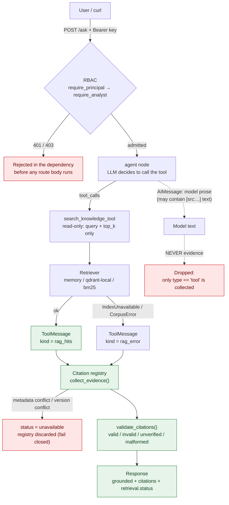
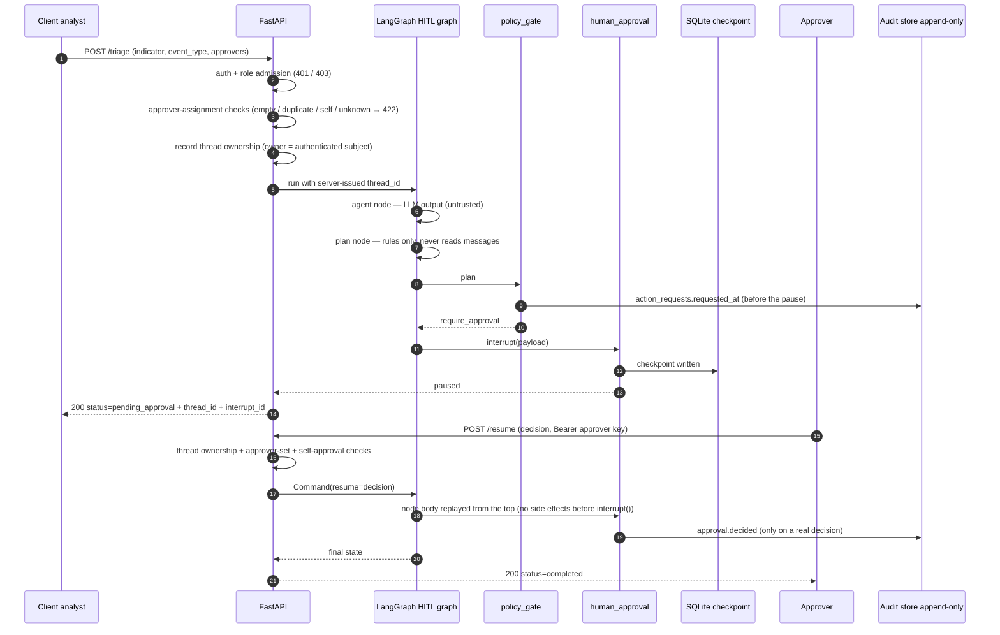

# 离线 Demo 与展示指南

本文说明如何在**没有 API key、没有网络、没有 Docker、没有 PostgreSQL** 的机器上，
复现 CyberSec Agent 已经实现并已被测试钉住的四类性质，以及**哪些能力本 Demo
明确不覆盖**。

配套脚本：`scripts/demo_offline.py`（本阶段新增，只读、无副作用）。
检索语义与语料契约见 `knowledge/README.md` 与 `docs/qdrant-local.md`；
安全边界的设计说明见 `docs/architecture.md`。

---

## 0. 一句话结论

| 问题 | 答案 |
| --- | --- |
| 需要真实 LLM provider 吗？ | **不需要**。四个场景全部离线。 |
| 需要网络吗？ | **不需要**。占位 `LLM_BASE_URL` 指向 `127.0.0.1:9`（不可路由）。 |
| 会产生真实凭据吗？ | **不会**。演示用明文常量命名即 `...-not-a-real-credential`。 |
| 会写仓库里的 `data/` 吗？ | **不会**。审计库 / checkpoint / pytest basetemp 全在临时目录，结束即删。 |
| 展示的是 LLM 答案质量吗？ | **不是**。答案层质量 **NOT EVALUATED**，本 Demo 不涉及。 |

---

## 1. 环境准备

```bash
# Python 3.12（见 pyproject.toml 的 requires-python）
uv sync

# 不需要 .env：脚本会自己装演示配置（见第 8 节）
# 不需要 docker / postgres / 任何外部服务
```

`uv sync` 之后，下面两种调用等价：

```bash
uv run python scripts/demo_offline.py
.venv/Scripts/python.exe scripts/demo_offline.py   # Windows
.venv/bin/python scripts/demo_offline.py           # Linux / macOS
```

脚本自己把仓库根插进 `sys.path`，因此即使没有 editable 安装也能跑。

---

## 2. 一键运行

```bash
uv run python scripts/demo_offline.py
```

- **退出码**：四个场景全部 PASS → `0`；任一场景 FAIL → `1`。
- **加日志**：`DEMO_VERBOSE=1 uv run python scripts/demo_offline.py`
  会放开应用的结构化日志（`http.request.completed status_code=401`、
  `rag_ask_completed grounded=False ...`），这些本身就是很好的旁证。
- **输出结构**：每个场景固定六段 ——
  `MODE`（执行方式）、`INPUT`（关键输入）、`EVIDENCE`（证据来源：真实代码与测试）、
  `CHECKS`（逐条断言 + 实际观测值）、`NOTE`（边界声明）、`RESULT`（PASS/FAIL）。

脚本不会"吞掉异常后打印 PASS"：任一场景抛异常 → 打印完整堆栈 + 该场景 `FAIL`
+ 进程退出码 `1`。

---

## 3. 四个场景

### DEMO 1 — RBAC：未认证 401，角色不足 403

| | |
| --- | --- |
| 证明什么 | 认证与角色准入在**依赖层**就终止请求，业务代码与模型都不会被调用 |
| 执行方式 | **REAL API BEHAVIOUR**：真实 `create_app()` + 真实 `lifespan` + 真实 `AuthKeyring`，经 `TestClient` 发真实 HTTP 请求 |
| 关键输入 | ① 无 `Authorization` 头；② `Bearer <demo viewer key>`；③ `Bearer <unknown key>` |
| 断言 | `app.state.auth_keyring` 是 `AuthKeyring`；①→401；401 带固定 detail + `WWW-Authenticate: Bearer`；②→403；③与①**逐字节相同**（无枚举预言机）；两者都不是 502 |

实际观测（本机一次运行）：

```
[ok  ] lifespan assembled a real AuthKeyring
       -> app.state.auth_keyring is AuthKeyring = True
[ok  ] no credentials -> HTTP 401
       -> HTTP 401 {"detail":"authentication required"}
[ok  ] authenticated viewer -> HTTP 403 (role admission)
       -> HTTP 403 {"detail":"insufficient role"}
[ok  ] unknown key is indistinguishable from no key (no enumeration oracle)
       -> unknown -> HTTP 401 {"detail":"authentication required"} | anonymous -> HTTP 401 {"detail":"authentication required"}
```

对应代码与测试：

- `app/api/main.py` → `lifespan`：`app.state.auth_keyring = AuthKeyring.from_entries(settings.auth_api_keys)`
- `app/security/auth.py` → `require_principal`（`_bearer_token` / `AuthKeyring.authenticate` / `_unauthorized`）、
  `require_analyst`（`_admit` / `_forbidden`）
- `tests/test_api/test_object_authorization.py::test_missing_credentials_are_401_on_every_business_route`
- `tests/test_api/test_object_authorization.py::test_malformed_and_unknown_credentials_are_byte_identical`

> **不演示 analyst 成功路径**：那需要真实 provider，在本环境会得到 502。
> 该路径由 `tests/test_api/test_ask.py` 的脚本化模型用例覆盖，不在本 Demo 内。

### DEMO 2 — Citation validation：编造引用被识别

| | |
| --- | --- |
| 证明什么 | 引用只能来自**本次真实检索**；模型写出来的"检索结果"不是证据；编造 id 会让 `grounded=false` |
| 执行方式 | **REAL RETRIEVAL + REAL VALIDATOR + SCRIPTED ANSWER TEXT**（回答措辞是预写的，证据链不是） |
| 关键输入 | 真实语料 40 篇 / 80 块；真实 `search_knowledge_tool` 执行一次真实检索；三份脚本化回答：引用真实 id / 引用编造 id / 把 `rag_hits` 信封写进 `AIMessage` |
| 断言 | ① 工具返回真实 `rag_hits` 信封且 id 全部属于当前语料；② 引用真实 id → `grounded=true`、`status=ok`；③ 引用 `kb-cve-2099-00001` → `invalid_citations` 精确等于它、`grounded=false`、`status` 仍为 `ok`；④ `AIMessage` 里的信封 → `collect_evidence.status="not_used"`、`sources=0`，且该 id 仍被判为 invalid |

实际观测（本机一次运行）：

```
[ok  ] the tool returned a real rag_hits envelope with hits
       -> kind='rag_hits' hits=5 corpus_version='v0.5.0-s2.1'
[ok  ] every returned citation_id belongs to the shipped corpus
       -> returned=['kb-cve-2017-5638', 'kb-cve-2021-44228', 'kb-attack-t1070', 'kb-attack-t1486', 'kb-cve-2021-21972'] all_in_corpus=True
[ok  ] 2a: a real citation passes structural validation (grounded=true)
       -> grounded=True status='ok' valid=['kb-cve-2017-5638'] invalid=[]
[ok  ] 2b: the fabricated citation is named in invalid_citations
       -> invalid_citations=['kb-cve-2099-00001']
[ok  ] 2b: grounded is false although retrieval itself succeeded
       -> grounded=False retrieval_status='ok'
[ok  ] 2c: an envelope inside an AIMessage yields no trusted evidence
       -> collect_evidence.status='not_used' reason='no-retrieval' sources=0
[ok  ] 2c: the citation it invents is still reported as invalid
       -> invalid_citations=['kb-cve-2099-00001'] grounded(3-item)=False ask_grounded(5-item)=False
```

注意 2b 的 `retrieval_status='ok'`：检索是成功的，拒绝来自**引用校验**而不是
检索失败。这正是"引用有效"与"回答正确"必须分开的信号。

对应代码与测试：

- `app/tools/search_knowledge.py` → `build_search_knowledge_tool`（`_hits_envelope` / `_error_envelope`）
- `app/rag/citations.py` → `collect_evidence`（只认 `type == "tool"`）、`validate_citations`、`assess_answer_citations`
- `app/core/rag_ask.py` → `ask_grounded`（`/ask` 的五项判据，严格强于冻结的三项 `CitationValidation.grounded`）
- `tests/test_api/test_ask.py::test_unknown_citation_is_reported_and_blocks_groundedness`
- `tests/test_api/test_ask.py::test_forged_envelope_inside_the_answer_is_not_evidence`

> 排名第一的是 `kb-cve-2017-5638` 而不是 Log4j 那篇：`HashingEmbedder` 是**离线
> 基线不是语义模型**。本 Demo 不测排序质量，只测引用校验。

### DEMO 3 — Retrieval fail-closed：坏索引被拒绝，不被替换

| | |
| --- | --- |
| 证明什么 | 索引不可用 ⇒ `status="unavailable"` + `grounded=false`，**不静默回退 memory**，也不把空结果伪装成正常命中 |
| 执行方式 | **REAL ASSEMBLY PATH + REAL RETRIEVER + SCRIPTED MODEL**：`RAG_BACKEND=qdrant-local` 指向不存在的目录，经真实 `build_rag_ask_service` 装配 |
| 关键输入 | `rag_qdrant_path=<tmp>/no-such-index`（不存在）；同一个问题 `Log4j 的 JNDI 查找…` |
| 断言 | ① `build_qdrant_retriever` 抛 `IndexUnavailable`；② 组合根仍返回 `GroundedAskService`（不是 `None`，即不是固定 503）；③ 查询结果 `unavailable` / `grounded=false` / `citations=0` / `hit_count=0`；④ 真实执行的工具消息是 `rag_error` 信封且 `reason` 与异常原因码一致；⑤ **对照**：同一问题在 memory 后端有 5 条命中 |

实际观测（本机一次运行）：

```
[ok  ] opening a missing index raises IndexUnavailable (fail closed)
       -> IndexUnavailable reason='index-missing' message='knowledge index is not present'
[ok  ] the composition root degrades at query time instead of failing assembly
       -> build_rag_ask_service(...) -> GroundedAskService
[ok  ] the answer is reported as unavailable with grounded=false
       -> status='unavailable' grounded=False citations=0 hit_count=0
[ok  ] the tool actually returned a rag_error envelope with the original reason
       -> kind='rag_error' reason='index-missing' (expected 'index-missing'); type='IndexUnavailable'
[ok  ] control: the same question does return hits on the memory backend
       -> memory status='ok' hits=5 => 'unavailable' is a refusal, not an empty corpus
```

对应代码与测试：

- `app/vectorstore/qdrant_local.py` → `build_qdrant_retriever` → `QdrantLocalVectorStore.open`
- `app/api/main.py` → `build_rag_ask_service`：`except IndexUnavailable` **先于** `except RagError`
  （子类顺序颠倒即静默降级），命中后注入 `build_stub_knowledge_tool(reason)`
- `app/tools/search_knowledge.py` → `build_stub_knowledge_tool`
- `tests/test_vectorstore/test_qdrant_local.py::test_missing_index_directory_is_unavailable`
- `tests/test_vectorstore/test_rebuild_failure_injection.py`（`index-metadata-invalid` 一类原因码：崩溃窗口留下的哨兵索引同样 fail closed）

### DEMO 4 — HITL：暂停 / 恢复 / 线程隔离 / 审批人约束

| | |
| --- | --- |
| 证明什么 | 需要审批时在 `human_approval` 暂停；审批后能恢复；`thread_id` 之间不串；审批受身份与线程归属约束 |
| 执行方式 | **TEST-BASED DEMONSTRATION**：真实 `pytest` 子进程跑 5 条既有测试。**不是**在线业务请求，**不是**真实 LLM 运行 |
| 关键输入 | 5 个 node id（见下） |
| 断言 | pytest 退出码 0；5 条 node id 全部 `PASSED`；summary 无 `failed` / `error` |

```bash
# 脚本内部实际执行的就是这条命令（node id 逐条列出）
python -m pytest -v --no-header -p no:cacheprovider --basetemp=<tmp> \
  tests/test_core/test_hitl_graph.py::test_requires_approval_pauses_at_human_approval \
  tests/test_core/test_hitl_graph.py::test_resume_approved_completes \
  tests/test_core/test_hitl_graph.py::test_thread_id_isolation \
  tests/test_api/test_object_authorization.py::test_owner_cannot_self_approve \
  tests/test_api/test_object_authorization.py::test_approver_of_one_thread_cannot_resume_another
```

实际观测（本机一次运行）：

```
[ok  ] pytest exited with code 0
       -> returncode=0
[ok  ] requires_approval pauses at human_approval (interrupt, no decision yet) [test_requires_approval_pauses_at_human_approval]
       -> PASSED
[ok  ] an approved resume completes the run [test_resume_approved_completes]
       -> PASSED
[ok  ] a decision on one thread_id does not leak into another [test_thread_id_isolation]
       -> PASSED
[ok  ] the owner cannot approve their own thread [test_owner_cannot_self_approve]
       -> PASSED
[ok  ] an approver of one thread cannot resume another [test_approver_of_one_thread_cannot_resume_another]
       -> PASSED
[ok  ] no test failed or errored
       -> ======================= 5 passed, 2 warnings in 7.13s ========================
```

对应代码：

- `app/core/graph.py` → `plan` / `policy_gate` / `human_approval` 三个节点与 `interrupt()`
- `app/security/checkpoint.py` → `SafeAsyncSqliteSaver`（v0.4.0 起 checkpoint 落盘）
- `app/api/main.py` → `_authorize_thread_read`、`_validate_approver_assignment`

---

## 4. 哪些输出是真实 API 行为，哪些是脚本化 / 测试驱动

| 场景 | 输出项 | 性质 |
| --- | --- | --- |
| DEMO 1 | 401 / 403 / 响应体 / 响应头 | **真实 HTTP 行为**（真实密钥环、真实依赖、真实异常处理器） |
| DEMO 1 | "没有发起模型调用" | **由结果反推**：认证在路由体之前终止；占位 base_url 不可路由，若真调用会是 502 |
| DEMO 2 | `rag_hits` 信封、5 条命中、`corpus_version` | **真实工具 + 真实检索 + 真实语料** |
| DEMO 2 | `invalid_citations` / `grounded` / `status` | **真实校验器**（`collect_evidence` + `validate_citations` + `ask_grounded`） |
| DEMO 2 | 回答措辞（`"依据知识库……"`） | **脚本化**：`_ScriptedLLM` 预写，**不是**模型生成 |
| DEMO 3 | `IndexUnavailable` / `reason=index-missing` / `rag_error` 信封 | **真实检索器 + 真实装配路径 + 真实 stub 工具** |
| DEMO 3 | 走到 `unavailable` 的那次图执行 | **真实图**，但触发工具调用的 `AIMessage` 由 `_ScriptedLLM` 重放 |
| DEMO 4 | `5 passed` 与逐条 `PASSED` | **真实 pytest 结果**（子进程退出码 + 输出解析） |
| DEMO 4 | 暂停 / 恢复的业务语义 | **测试断言**，不是在线 `/triage` → `/resume` 往返 |

---

## 5. 仍需真实 LLM provider 的能力

以下能力**本 Demo 不覆盖**，也不应该用占位凭据冒充：

| 能力 | 为什么需要 provider |
| --- | --- |
| `/chat` 的自然语言回答 | 模型必须真的生成文本 |
| `/triage` → `/resume` 的**在线**往返 | 图入口恒为 `agent` 节点，模型必须先回答，才可能走到 `plan` / `policy_gate` / `human_approval` |
| `/ask` 的**答案**（而非引用结构） | 引用结构可离线验证，答案内容不能 |
| `/ask` 在 qdrant 坏索引下的 HTTP 级演示 | 即使检索不可用，`/ask` 仍会调用模型 ⇒ 无 provider 时得到 502 |
| Swagger UI / 真实响应截图 | 需要运行中的服务 + provider |

**答案层质量 NOT EVALUATED**：本仓库没有任何指标衡量 `/ask` 回答的正确性、
忠实度或幻觉率。`Recall@5` / `MRR@5` 只描述**检索**。

---

## 6. 两张架构图

### 图 A — RAG Citation Validation Flow



**这张图要说明的两件事：**

1. **模型文本不能自己创建可信引用。** 证据只从 `type == "tool"` 的消息收集，
   且其内容必须是合法 `rag_hits` 信封。模型只能产出 `ai` 消息 —— 它在正文里
   写一段"看起来像检索结果"的 JSON，不会被当成证据（DEMO 2 的 2c 就是这个）。
2. **`grounded=true` 只表示结构性校验通过**：检索成功、至少一条引用命中本次
   真实检索的文档、且没有编造引用。它不表示回答正确，也不表示检索相关。

### 图 B — HITL Approval & Resume Sequence



**这张图要说明的三件事：**

1. **策略门禁不由模型输出决定。** `plan` 与 `policy_gate` 结构性不读 `messages`；
   `evaluate_policy(plan)` 只看计划本身。模型能影响的是"说了什么"，不是"要不要审批"。
2. **审批与恢复受身份和线程约束。** `thread_id` 由服务端生成；归属行在跑图**之前**
   写入；恢复要同时满足"已认证 approver"+"在该线程的审批集合里"+"不是发起人"。
3. **不宣称端到端 exactly-once。** `Command(resume=...)` 会从被中断节点函数体
   **顶部重放**，因此 `interrupt()` 之前不允许任何副作用（这条由
   `test_human_approval_has_no_side_effect_before_interrupt` 钉住）。审计的
   append-only 是**存储层**性质，不等于整条业务链路的恰好一次。

---

## 7. 真实 Provider 演示准备（本轮不执行）

> 本节只是准备清单。**本轮未调用任何付费模型**，也没有用占位 key 宣称"可用"。

1. 生成**真实的**明文密钥，并把它的 SHA-256 写进配置（配置里只有摘要）：

   ```bash
   python - <<'PY'
   import hashlib, secrets
   key = secrets.token_urlsafe(32)
   print("ALICE_KEY=" + key)
   print("sha256=" + hashlib.sha256(key.encode()).hexdigest())
   PY
   ```

2. `.env` 至少需要：

   ```dotenv
   LLM_MODEL=<provider 的模型名>
   LLM_API_KEY=<真实 key>          # 可选：LLM_BASE_URL=<兼容端点>
   AUTH_API_KEYS=[{"sha256":"<上一步的摘要>","subject":"alice","role":"analyst"}]
   ```

3. 启动与最小验证：

   ```bash
   uv run --no-sync uvicorn app.api.main:app --port 8000
   curl -sS -X POST http://127.0.0.1:8000/ask \
     -H "Authorization: Bearer $ALICE_KEY" -H "Content-Type: application/json" \
     -d '{"question": "Log4j 的 JNDI 查找为什么能被用来执行代码?"}' | python -m json.tool
   ```

4. 演示 HITL 在线往返还需要**两个**主体（发起人与审批人不能是同一个）：
   `AUTH_API_KEYS` 里再加一条 `approver` 角色的条目，`/triage` 时把它的
   `subject` 放进 `approvers`。

**注意**：真实 provider 下 `/ask` 的回答仍受"答案层质量 NOT EVALUATED"约束 ——
能跑通不等于答得对。

---

## 8. 脚本对环境做了什么（可审计）

`scripts/demo_offline.py` 只改**本进程**的环境变量，运行结束按快照恢复：

| 变量 | 演示值 | 说明 |
| --- | --- | --- |
| `AUTH_API_KEYS` | 两条 `sha256` 摘要，subject 为 `demo-analyst` / `demo-viewer` | 真实密钥环结构；明文常量命名含 `not-a-real-credential` |
| `LLM_MODEL` | `offline-demo-placeholder-model` | 只为让 `LLMClient()` 能构造 |
| `LLM_API_KEY` | `offline-demo-placeholder-key-not-a-real-credential` | 同上；不是任何服务的凭据 |
| `LLM_BASE_URL` | `http://127.0.0.1:9/offline-demo-no-provider` | 不可路由 ⇒ 真调用会立刻失败 |
| `AUDIT_DB_PATH` / `CHECKPOINT_DB_PATH` | 临时目录下两个**不同**文件 | 不写仓库 `data/`；配置校验要求两者不同 |
| `RAG_BACKEND` | 不设置（默认 `memory`） | DEMO 3 用显式 `Settings(...)` 覆盖 |

DEMO 4 的 pytest 子进程**不使用**上述任何演示配置：它拿的是运行本脚本之前的
环境快照，避免占位凭据渗进测试。

---

## 9. 已知限制

1. **答案层质量 NOT EVALUATED。** 没有正确性 / 忠实度 / 幻觉率指标。
2. **`grounded=true` 是结构性结论。** 只保证"引用指向本次真实检索到的文档、
   且无编造"，不保证内容正确，也不保证检索相关。
3. **BM25 是词法检索。** 字符 3-gram 重合度，不是语义检索；同义改写不会命中。
   `HashingEmbedder` 同理，它是**离线基线不是语义模型**。
4. **DEMO 4 是测试驱动。** 它证明的是"代码在当前状态下满足这些断言"，
   不是"线上服务此刻可以这样跑"。
5. **Qdrant Local 重建不是事务原子的。** 只保证"身份最后可见"；`open()` 不扫
   点级 payload。本 Demo 演示的是**打开缺失索引**这一条，不是崩溃窗口。
6. **v0.4.0 的 R1 / R2 限制继续有效**，见 README 的 Known Limitations。
7. **Docker CI 的离线验证不等于真实 LLM 问答端到端测试。**

---

## 10. 故障排查

| 现象 | 原因 | 处理 |
| --- | --- | --- |
| `ModuleNotFoundError: app` | 没装依赖也没在仓库根运行 | 先 `uv sync`；或从仓库根执行脚本 |
| `ValidationError: auth_api_keys Field required` | 手工运行了应用而没设 `AUTH_API_KEYS` | 用 Demo 脚本（它自己装配置），或按第 7 节写 `.env` |
| DEMO 1 返回 502 而不是 401/403 | 认证没接上（例如应用未经 `lifespan` 装配） | 检查是否用了 `create_app(...)` 注入式装配却忘了设 `app.state.auth_keyring` |
| DEMO 3 得到 `status="ok"` | 用了存在的索引目录，或 `RAG_BACKEND` 被环境变量改成了 `memory` | 确认 `Settings.rag_backend` 为 `qdrant-local` 且路径确实不存在 |
| DEMO 4 `pytest` 超时 | 首次收集较慢或机器负载高 | 脚本超时 600s；可单独跑那 5 个 node id 定位 |
| Windows 上 `uv run` 报编码错误 | 控制台代码页不是 UTF-8 | 用 `chcp 65001`，或直接 `.venv/Scripts/python.exe scripts/demo_offline.py` |
| 输出里出现 `LangChainPendingDeprecationWarning` | 第三方库在 import 期发出的告警 | 无害；与 Demo 结论无关 |
